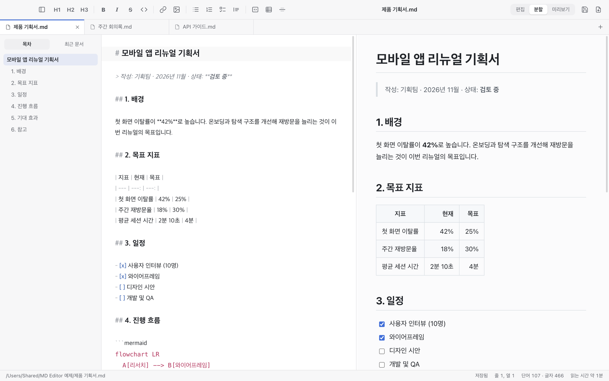
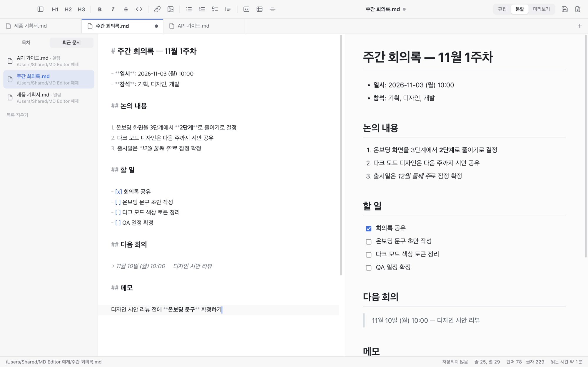
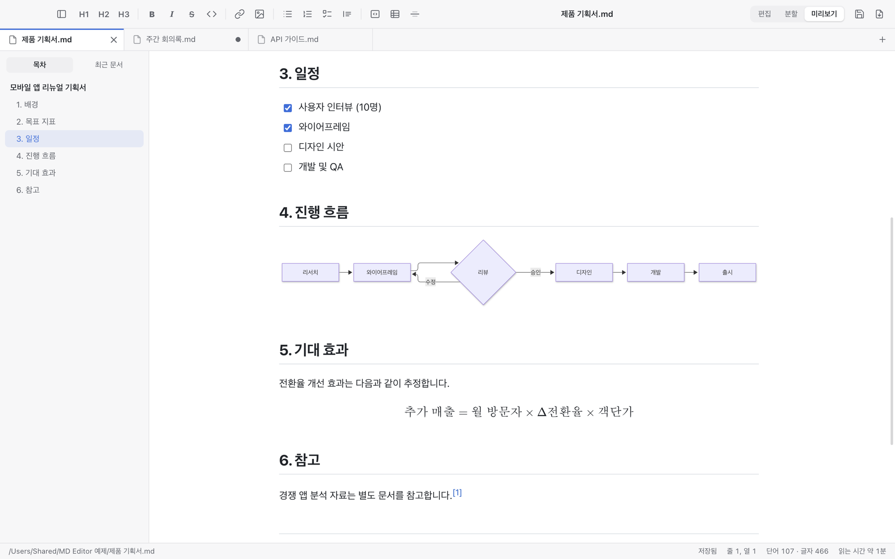
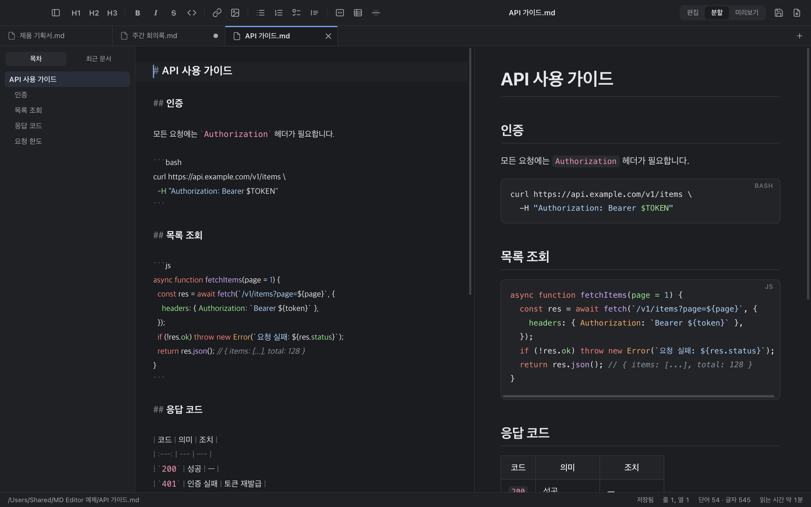
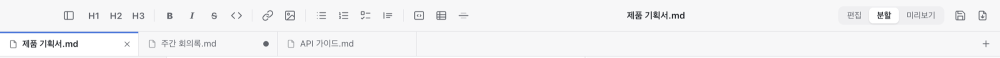

<p align="center">
  
</p>

<h1 align="center">MD Editor</h1>

<p align="center">
  Mac과 Windows에서 쓰는 깔끔한 마크다운 편집기<br>
  <b>실시간 미리보기 · 탭 · 다이어그램과 수식 · PDF/HTML 내보내기 · 버튼 한 번 업데이트</b>
</p>

<p align="center">
  <a href="https://github.com/ReentaKim/md-editor/releases/latest"><b>⬇️ 최신 버전 내려받기</b></a> ·
  <a href="#-설치">설치 방법</a> ·
  <a href="#-사용-가이드">사용 가이드</a> ·
  <a href="#️-단축키">단축키</a>
</p>



---

## ✨ 이런 걸 할 수 있어요

### ✍️ 쓰면서 바로 확인하기

왼쪽에서 마크다운을 쓰면 오른쪽 미리보기가 **입력하는 즉시** 바뀝니다. 한쪽을 스크롤하면 다른 쪽도 같은 위치로 따라옵니다. 미리보기의 문단을 **더블클릭**하면 편집기가 그 문장의 원본 위치로 이동합니다.

보기 방식은 상단 오른쪽에서 바꿀 수 있습니다. **편집 · 분할 · 미리보기** 중에 고르거나 `⌘1` `⌘2` `⌘3`을 누르세요.

### 📑 여러 문서를 탭으로

문서를 열 때마다 새 창이 뜨지 않고 **한 창 안에 탭으로** 열립니다.

- 탭마다 실행 취소 기록과 스크롤 위치가 따로 유지됩니다.
- 저장하지 않은 탭에는 **●** 표시가 붙습니다.
- 탭은 끌어서 순서를 바꿀 수 있습니다.
- 왼쪽 사이드바의 **최근 문서**에서 전에 열었던 파일을 바로 열 수 있습니다.



### 📊 다이어그램과 수식

` ```mermaid ` 코드 블록을 쓰면 **흐름도·순서도 같은 다이어그램**이 그려집니다. `$...$`, `$$...$$`로 감싸면 **수식**이 됩니다. 체크리스트는 미리보기에서 **클릭해서 체크**할 수 있고, 원본의 `[ ]` / `[x]`도 함께 바뀝니다.



### 🌙 다크 모드와 코드 하이라이트

**보기 → 테마**에서 시스템 설정 따르기 · 라이트 · 다크 중에 고를 수 있습니다. 코드 블록은 언어별로 색이 입혀지고, 마우스를 올리면 **복사** 버튼이 나타납니다.



### 🔄 버튼 한 번으로 업데이트

새 버전이 나오면 오른쪽 아래에 알림이 뜹니다. **[업데이트] → [지금 재시작]** 두 번이면 끝납니다. 받은 파일은 SHA-256과 코드 서명이 맞을 때만 설치되고, 설치에 실패하면 기존 앱을 그대로 둡니다.

<p align="center">
  
</p>

### 그 밖에

- **이미지 붙여넣기**: 스크린샷을 `⌘V`로 붙여넣거나 이미지 파일을 끌어다 놓으면, 문서 옆 `assets/` 폴더에 저장되고 링크가 자동으로 들어갑니다.
- **PDF · HTML 내보내기**: 다크 모드를 쓰고 있어도 PDF는 인쇄하기 좋은 밝은 화면으로 만들어집니다.
- **다른 프로그램과 함께 쓰기**: 다른 프로그램에서 같은 파일을 고치면 자동으로 다시 불러옵니다. 편집 중이었다면 먼저 확인을 받습니다.
- **오프라인 동작**: 인터넷이 없어도 미리보기·다이어그램·수식이 모두 동작합니다.
- **한국어 문서에 맞춤**: `**42%**로`처럼 굵게 표시 바로 뒤에 조사가 붙어도 제대로 표시됩니다.

---

## 📦 설치

| | Mac | Windows |
| --- | --- | --- |
| 지원 환경 | macOS · Apple Silicon(M1 이상) | Windows 10/11 · 64비트 |
| 설치 파일 | `MD-Editor-<버전>-arm64.dmg` | `MD-Editor-Setup-<버전>-x64.exe` |
| 한 줄 설치 | 터미널 | PowerShell |

### 🍎 Mac

**방법 1. 터미널에 한 줄 붙여 넣기 (추천)**: **터미널** 앱(Spotlight에서 "터미널" 검색)을 열고 아래 한 줄을 붙여 넣은 뒤 Enter를 누르세요.

```bash
curl -fsSL https://raw.githubusercontent.com/ReentaKim/md-editor/main/install.sh | sh
```

최신 버전을 내려받아 SHA-256으로 확인한 뒤 **응용 프로그램** 폴더에 설치하고 실행합니다. 이 방법으로 설치하면 보안 경고가 뜨지 않습니다. ([install.sh](install.sh))

**방법 2. DMG 내려받아 설치**

1. [최신 릴리스](https://github.com/ReentaKim/md-editor/releases/latest)에서 `MD-Editor-<버전>-arm64.dmg`를 내려받습니다.
2. DMG를 열고 **MD Editor**를 **Applications** 폴더로 끌어다 놓습니다.
3. 처음 실행하면 *"Apple에서 확인할 수 없습니다"* 경고가 뜹니다. Apple 공증을 받지 않은 앱이기 때문입니다. **완료**를 누르고 **시스템 설정 → 개인정보 보호 및 보안**에서 **그래도 열기**를 누르세요. 처음 한 번만 하면 됩니다.

### 🪟 Windows

**방법 1. PowerShell에 한 줄 붙여 넣기 (추천)**: 시작 메뉴에서 **PowerShell**을 열고 아래 한 줄을 붙여 넣은 뒤 Enter를 누르세요.

```powershell
irm https://raw.githubusercontent.com/ReentaKim/md-editor/main/install.ps1 | iex
```

최신 버전을 내려받아 SHA-256으로 확인한 뒤 설치하고 실행합니다. 관리자 권한은 필요 없고, 시작 메뉴와 바탕화면에 바로가기가 만들어집니다. ([install.ps1](install.ps1))

**방법 2. 설치 파일 내려받아 실행**

1. [최신 릴리스](https://github.com/ReentaKim/md-editor/releases/latest)에서 `MD-Editor-Setup-<버전>-x64.exe`를 내려받아 실행합니다.
2. *"Windows의 PC 보호"* 파란 창이 뜨면 **추가 정보 → 실행**을 누르세요. 코드 서명 인증서가 없는 앱이라 처음 한 번 뜹니다.
3. 별도 질문 없이 바로 설치되고 앱이 실행됩니다. 설치 위치는 `%LOCALAPPDATA%\Programs`입니다.

### 🤖 Claude Code에게 부탁하기

Claude Code를 쓰고 있다면 Mac이든 Windows든 이렇게 요청하면 됩니다.

```
https://github.com/ReentaKim/md-editor 의 설치 스크립트로 MD Editor 설치해줘
```

---

## 📖 사용 가이드

### 문서 열기와 저장

| 하고 싶은 일 | 방법 |
| --- | --- |
| 새 문서 | `⌘N` 또는 탭 바의 **+** / 탭 바 빈 곳 더블클릭 |
| 파일 열기 | `⌘O`, 또는 `.md` 파일을 창에 끌어다 놓기 |
| 최근 문서 열기 | 왼쪽 사이드바 **최근 문서** 탭, 또는 **파일 → 최근 문서** |
| 저장 / 다른 이름으로 저장 | `⌘S` / `⇧⌘S` |
| 자동 저장 켜기 | **파일 → 자동 저장** (입력이 멈추고 약 1초 뒤 저장) |
| 탭 닫기 / 창 닫기 | `⌘W` / `⇧⌘W` (마지막 탭을 닫으면 빈 "제목 없음" 탭이 남습니다) |
| Finder에서 파일 위치 보기 | `⇧⌘R` 또는 아래 상태바의 파일 경로 클릭 |

### 서식 넣기

상단 툴바 버튼이나 단축키로 서식을 넣을 수 있습니다. 글자를 선택한 뒤 누르면 선택한 부분에 적용되고, 같은 버튼을 한 번 더 누르면 해제됩니다.



### 이미지 넣기

1. 문서를 한 번 저장합니다. 이미지를 문서 옆에 저장해야 하기 때문입니다.
2. 스크린샷을 `⌘V`로 붙여넣거나, 이미지 파일을 편집기에 끌어다 놓습니다.
3. 이미지는 `assets/` 폴더에 저장되고, `` 링크가 자동으로 들어갑니다.

### 내보내기

- **PDF**: `⌘P` (A4, 인쇄용 밝은 테마)
- **HTML**: `⇧⌘E` (스타일이 포함된 HTML 파일 하나로 저장)

### 마크다운 문법 예제

**도움말 → 마크다운 문법 예제 열기**를 누르면, 지원하는 문법(표, 체크리스트, 코드, 수식, 다이어그램, 각주 등)을 모아 둔 예제 문서가 새 탭으로 열립니다.

### `.md` 파일을 항상 MD Editor로 열기

- **Mac**: Finder에서 아무 `.md` 파일을 선택하고 `⌘I`(정보 가져오기)를 누릅니다. **다음으로 열기**에서 MD Editor를 고른 뒤 **모두 변경**을 누르세요.
- **Windows**: 설치하면 `.md` 파일이 MD Editor에 연결됩니다. 다른 앱으로 열린다면 `.md` 파일을 오른쪽 클릭하고 **연결 프로그램 → 다른 앱 선택 → MD Editor**를 고른 뒤 **항상**을 누르세요.

---

## ⌨️ 단축키

> Windows에서는 `⌘` → `Ctrl`, `⌥` → `Alt`, `⇧` → `Shift`로 바꿔 누르세요. 앱 안의 버튼 설명에는 Windows 표기로 나옵니다.

| 분류 | 기능 | 단축키 |
| --- | --- | --- |
| 보기 | 편집기만 / 분할 / 미리보기만 | `⌘1` / `⌘2` / `⌘3` |
| | 사이드바 열고 닫기 | `⌘\` |
| | 확대 / 축소 / 실제 크기 | `⌘=` / `⌘-` / `⌘0` |
| 탭 | 새 탭 / 새 창 | `⌘N` / `⇧⌘N` |
| | 다음 탭 / 이전 탭 | `⌃Tab` / `⌃⇧Tab` (또는 `⇧⌘]` / `⇧⌘[`) |
| 서식 | 굵게 / 기울임 / 취소선 | `⌘B` / `⌘I` / `⇧⌘X` |
| | 인라인 코드 / 링크 | `⌘E` / `⌘K` |
| | 제목 1·2·3 / 본문 | `⌥⌘1` `⌥⌘2` `⌥⌘3` / `⌥⌘0` |
| | 글머리 / 번호 / 체크리스트 / 인용 | `⇧⌘8` / `⇧⌘7` / `⇧⌘9` / `⇧⌘.` |
| | 코드 블록 / 표 | `⌥⌘C` / `⌥⌘T` |
| 편집 | 찾기·바꾸기 | `⌘F` |
| 파일 | PDF / HTML 내보내기 | `⌘P` / `⇧⌘E` |

---

## 🔄 업데이트

새 버전이 나오면 앱 오른쪽 아래에 알림이 뜹니다. **[업데이트] → [지금 재시작]**을 누르면 됩니다. 메뉴의 **MD Editor → 업데이트 확인…**으로 직접 확인할 수도 있습니다.

- **Mac**: 처음 업데이트할 때 macOS가 "앱 관리" 권한을 물을 수 있습니다. **시스템 설정 → 개인정보 보호 및 보안 → 앱 관리**에서 MD Editor를 허용해 주세요.
- **Windows**: 새 설치 파일을 받아 조용히 다시 설치한 뒤 앱을 다시 실행합니다. 관리자 권한은 묻지 않습니다. 업데이트 확인 메뉴는 **도움말 → 업데이트 확인…**에 있습니다.
- 알림을 끄려면 **자동으로 업데이트 확인**의 체크를 해제하세요(Mac: MD Editor 메뉴, Windows: 도움말 메뉴).
- v0.2.x 이하 버전에는 앱 안 업데이트 기능이 없습니다. 위의 설치 방법으로 한 번만 다시 설치해 주세요.

## 🗑️ 삭제

- **Mac**: **응용 프로그램** 폴더의 MD Editor를 휴지통으로 옮기면 됩니다. 설정(최근 문서 등)까지 지우려면 `~/Library/Application Support/MD Editor` 폴더도 함께 삭제하세요.
- **Windows**: **설정 → 앱 → 설치된 앱**에서 MD Editor의 **⋯ → 제거**를 누릅니다. 설정까지 지우려면 `%APPDATA%\MD Editor` 폴더도 함께 삭제하세요.

---

## 🛠️ 개발

```bash
npm install
npm start        # 빌드 후 실행
npm run dist     # release/<버전>/ 에 Mac용 .dmg 생성 (Apple Silicon)
npm run dist:win # release/<버전>/ 에 Windows용 설치 파일 생성 (Mac에서도 빌드 가능)
```

Electron + CodeMirror 6 + markdown-it(+ KaTeX, highlight.js, Mermaid, DOMPurify)로 만들었습니다. 모든 라이브러리는 앱 안에 함께 들어 있어서 인터넷 없이 동작합니다. 렌더러는 `sandbox` + CSP 환경에서 실행되고, 폴더를 탐색하는 API는 없습니다.

| 경로 | 역할 |
| --- | --- |
| `src/main/main.js` | 창·탭 상태, 메뉴, 파일 입출력, 외부 변경 감지, PDF 내보내기 |
| `src/main/updater.js` | 앱 안 업데이트: GitHub 릴리스 확인 → 다운로드 → SHA-256·서명 검증 → 교체 |
| `src/main/preload.js` | 렌더러에 노출하는 최소 API (`window.api`) |
| `src/renderer/app.js` | 탭, 미리보기, 목차, 최근 문서, 스크롤 동기화, 저장, 업데이트 알림 |
| `src/renderer/editor.js` | CodeMirror 6 편집기와 서식 명령 |
| `src/renderer/markdown.js` | 마크다운 렌더링(한국어 강조 보완 포함)과 Mermaid |
| `src/renderer/preview.css` | 문서 스타일 (HTML 내보내기에도 그대로 들어감) |
| `install.sh` / `install.ps1` | 사용자용 설치 스크립트 (Mac / Windows) |

**릴리스 규칙:** 태그는 `v<버전>`으로 붙이고, 같은 릴리스에 Mac용 `MD-Editor-<버전>-arm64.dmg`와 Windows용 `MD-Editor-Setup-<버전>-x64.exe`를 함께 올립니다. 두 파일 모두 Mac에서 빌드할 수 있습니다. 앱의 업데이트 기능과 설치 스크립트가 이 이름으로 파일을 찾습니다. 변경 이력은 [CHANGELOG.md](CHANGELOG.md)에 있습니다.

## 라이선스

[MIT](LICENSE) © ReentaKim
